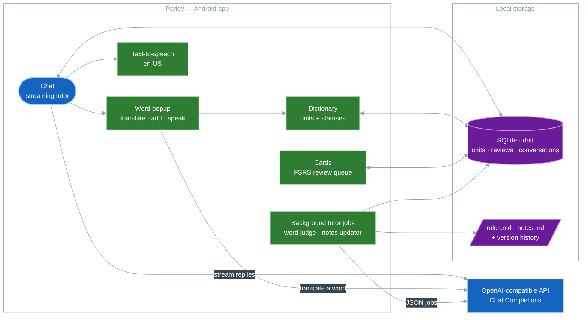

# Parley

[](https://github.com/0resuto/parley/actions/workflows/ci.yml)


An Android app for improving English by talking to an AI tutor. The chat is the
core: the tutor keeps the conversation inside the words you already know, steers
toward the words you are learning, and wraps a few new ones in `[[brackets]]`
so you can tap them. A dictionary, FSRS flashcards and two plain Markdown
documents (`rules.md`, `notes.md`) feed and steer the conversation.

## How it works



- **Chat** — streaming tutor replies with Stop/Retry, several conversations, and
  every failure mapped to a clear message (offline, rejected key, rate limit, ...).
- **Tutor documents** — `rules.md` and `notes.md` are plain Markdown you can read
  and edit in the app; the tutor may change the rules only when you ask, and every
  change comes with an Undo chip.
- **Dictionary** — every word in chat is tappable: the popup translates English to
  Russian, adds the word with its inflections, and counts as a light "Again"
  review at most once per day.
- **Cards** — an FSRS due queue (Again / Hard / Good / Easy) with "Mark as known";
  known words stay in the dictionary but leave the queue.
- **Background tutor jobs** — after each reply a word judge rates how you handled
  the target words, and a notes updater rewrites `notes.md` (best-effort,
  offline-aware).
- **Voice** — assistant replies can be played with `flutter_tts` (en-US), with an
  auto-play option.
- **Data** — JSON export/import (merge by word) and CSV import (`word;translation`).

## Requirements

- Flutter stable (Dart 3) with the Android toolchain
- An Android device or emulator (the app is Android-only)
- An OpenAI-compatible Chat Completions endpoint: base URL, API key, model
  (anything that speaks `POST <base>/chat/completions`)

## Setup

```bash
git clone https://github.com/0resuto/parley.git
cd parley
flutter pub get
flutter run
```

Then open **Settings → AI provider**, fill in the base URL, API key and model,
and tap **Test connection**. Everything that can work offline does; online-only
actions show a clear message when there is no connection.

## Configuration

- **AI provider** — base URL, API key (kept in `flutter_secure_storage`), and a
  free-text model name.
- **Tutor** — new-word density (0–30 %) and editors for `rules.md` (max 6000
  chars) and `notes.md` (max 8000 chars) with version history.
- **Voice** — auto-play replies and speech speed (0.5–1.5×).
- **Data** — JSON export/import and CSV import.

## Project layout

```text
lib/
├── main.dart · app.dart      # entry point and root widget
├── core/                     # theme, failures, clock, constants, JSON helper
├── data/                     # drift database, models, repositories
├── services/                 # FSRS, LLM client, documents, TTS/STT, export, tutor jobs
└── features/                 # chat, cards, dictionary, settings (screens, widgets, controllers)
assets/templates/             # seed rules.md and notes.md
test/                         # unit and widget tests (mirrors lib/)
```

## Development

```bash
dart format .
flutter analyze
flutter test
```

Pre-commit checks run on every commit (formatting + analysis) and the test
suite runs before every push. Install the hooks once per clone (requires
`dart` and `flutter` on `PATH`):

```bash
python -m pip install --user pre-commit
pre-commit install
pre-commit install --hook-type pre-push
```

Commits follow [Conventional Commits](https://www.conventionalcommits.org/)
and releases use [Semantic Versioning](https://semver.org/); release notes
live in GitHub Releases.

## License

The app code is MIT — see [LICENSE](LICENSE). The bundled English–Russian
dictionary data (`assets/dictionary/`, built by `tool/build_dictionary.py`
from the [kaikki.org](https://kaikki.org/dictionary/English/) Wiktionary
extract) comes from Wiktionary and is licensed CC BY-SA.
